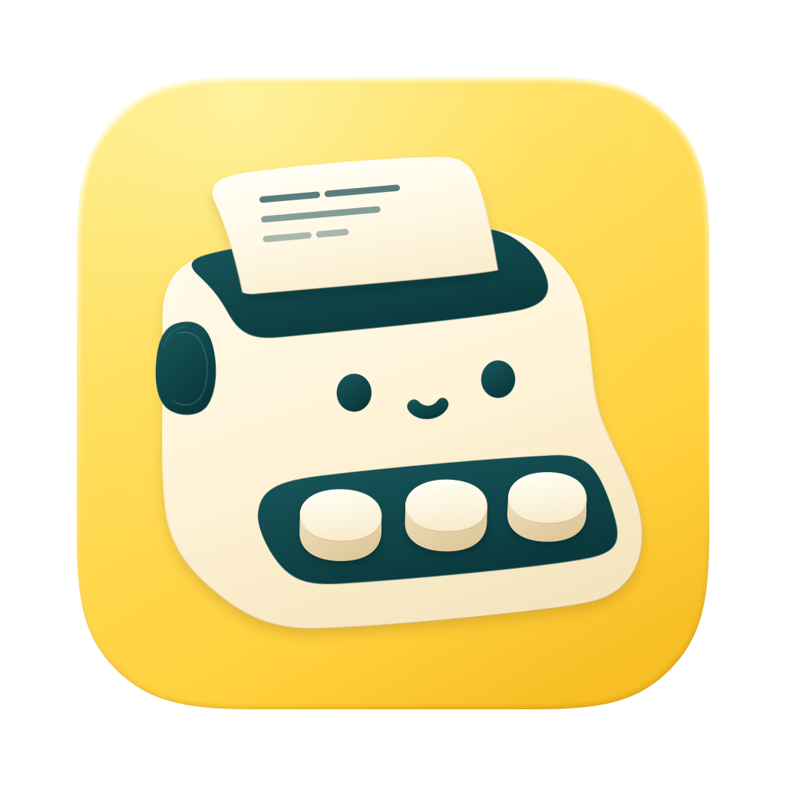

# Sayso

Sayso is a macOS menu bar app that types local Whisper dictation directly into the text field you’re using. Speech is processed on your Mac. The app keeps audio in memory and leaves your clipboard alone.

## Start dictating

1. Quit the previous VoiceKey version if it’s running. Unzip **Sayso.app**, move it to **Applications**, and open it. This build supports Apple silicon on macOS 14 or later.
2. Click the typewriter in the menu bar, choose **Nava · فارسی** for Persian or **Whisper Large v3 Turbo** for multilingual dictation, and click **Download**.
3. Click where you want to type and press **Option–Shift–Space**. On first use, allow **Accessibility** for keyboard entry and **Microphone** for recording. Return to the text field and press the shortcut again if prompted.
4. Speak naturally. A brief pause sends each phrase for recognition. During continuous speech, Sayso also processes short sections. Press the shortcut again, or click the recording icon in the menu bar, to finish the last phrase. Keep the destination field focused until typing finishes.

Twelve bars in the floating indicator rise and fall with your voice. When you stop recording, the same bars rotate in place while Sayso finishes typing, then the indicator disappears. Your text field keeps focus. If another app owns the shortcut, use **Start dictation** in the popover or choose a different shortcut in Settings. Secure fields and apps that ignore synthetic Unicode keyboard events may not accept dictation.

## Models and settings

| Model | Download | When to choose it |
| --- | ---: | --- |
| Nava · فارسی | 574 MB | Default for new installations. Fine-tuned for Persian, with the recognition language fixed to Persian. |
| Whisper Large v3 Turbo | 574 MB | Multilingual dictation with automatic language detection. |

In **Settings → Models → Spoken language**, choose **Persian · فارسی** to skip language detection on multilingual models. Latency depends on the model, your Mac and how often you pause. Sayso reuses the loaded model and requests Metal acceleration when a GPU is available.

Downloads can be paused and resumed and are verified by size and SHA-256. **Unload** frees the model while keeping the download. **Move to Trash** removes it. Existing models and preferences use the original VoiceKey bundle identifier and the folder `~/Library/Application Support/VoiceKey/Models/`.

By default, double-tap **Right Shift** and hold the second press to dictate. Release it to stop. Existing shortcut preferences are preserved.

In **Settings → Recording**, choose **Toggle** to perform the same gesture to start and stop, or **Hold** to stop when you release the shortcut.

| Shortcut gesture | Toggle recording | Hold recording |
| --- | --- | --- |
| Tap | Press and release to start or stop. | Press to start immediately. |
| Hold | Hold for 0.35 seconds to start or stop. | Recording starts after 0.35 seconds. |
| Double tap | Tap twice to start or stop. | Tap once, then press and hold on the second tap. |

Every shortcut needs Command, Control, Option, or Shift. Tap requires a combination and excludes Shift plus a letter so you can type capitals. Hold and Double tap also accept an individual modifier, such as left Shift. Double tap follows your Mac’s double-click interval. Enable soft recording sounds for audible start and stop cues. The floating indicator respects Reduce Motion.

## Updates

If you use a previous 1.1–1.9 release, install 1.0.13 once from GitHub Releases. Those apps compare version numbers numerically and will skip 1.0.13.

Sayso checks the latest stable release on [GitHub](https://github.com/seenpeh/sayso/releases) at launch, when reopened and every 24 hours while running. You can also use **Settings → General → Check for Updates**. Select **Install … and restart** to download the release, verify its checksum and app signature, replace the current copy and reopen it. Install the app in a writable folder before updating.

## Build and release

Install the Xcode Command Line Tools and run this on an Apple silicon Mac.

```sh
./build.sh "$PWD/Sayso-1.0.13-macOS-arm64.zip"
```

To publish an update, bump the version and build number in `Resources/Info.plist`. Create a stable GitHub release with a matching numeric tag such as `v1.0.13` and attach the build as `Sayso-1.0.13-macOS-arm64.zip`. A DMG with the same base name and the app at its root also works. The updater selects the matching architecture and verifies the SHA-256 digest supplied by GitHub. The local build is ad hoc signed.

The runtime is [whisper.cpp v1.8.4](https://github.com/ggml-org/whisper.cpp/releases/tag/v1.8.4). Weights come from [Nava GGML](https://huggingface.co/Nimruz/Nava-ggml) and the [multilingual Whisper collection](https://huggingface.co/ggerganov/whisper.cpp).
